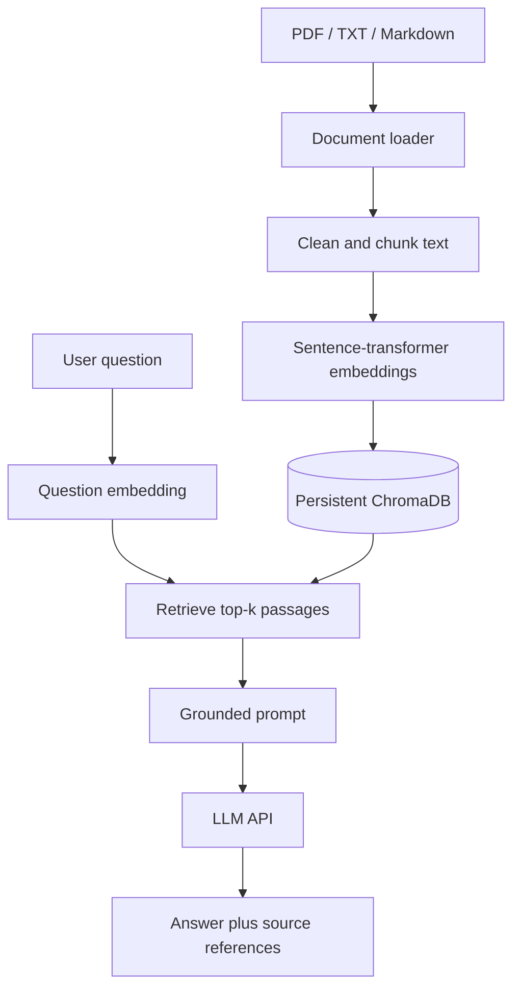

# RAG Knowledge Assistant

A learning-focused Retrieval-Augmented Generation (RAG) API that lets you upload PDF, TXT, and Markdown documents, retrieve relevant passages using semantic search, and generate answers grounded in those passages.

> **Status:** Educational starter project. Review security, access control, monitoring, ingestion limits, and evaluation before using it with confidential or production data.

## What it demonstrates

- PDF, TXT, and Markdown text extraction
- Character-based text chunking with overlap and page metadata
- Local sentence-transformer embeddings
- Persistent Chroma vector storage
- Top-k similarity retrieval
- Context-grounded LLM answers with source excerpts
- FastAPI endpoints, automated tests, Docker packaging, and GitHub Actions

## Architecture



## Project structure

```text
rag-knowledge-assistant/
├── src/rag_app/
│   ├── api/                 # FastAPI route handlers
│   ├── embeddings/          # Embedding model wrapper
│   ├── generation/          # Prompt construction and LLM client
│   ├── ingestion/            # PDF/text loading, cleaning and chunking
│   ├── retrieval/            # Top-k retrieval interface
│   ├── schemas/              # Pydantic request/response models
│   ├── services/             # End-to-end RAG orchestration
│   ├── vectorstore/          # Vector store abstraction and Chroma adapter
│   ├── config.py
│   └── main.py
├── data/sample_documents/   # Add your own permitted sample documents locally
├── docs/                    # Architecture and evaluation notes
├── scripts/                 # Batch ingestion helper
├── tests/
├── .env.example
├── requirements.txt
├── requirements-test.txt
├── Dockerfile
└── docker-compose.yml
```

## Prerequisites

- Python 3.11 or 3.12 recommended
- Git (optional)
- An OpenAI API key if you want LLM-generated answers
- Internet access on first run to download the sentence-transformer model

The embedding model runs locally after download. The answer-generation request sends the question and retrieved text to the configured LLM provider. Do not upload confidential material unless the provider and your organization permit that processing.

## Run locally

### 1. Clone the repository

```bash
git clone https://github.com/vicky123444/rag-knowledge-assistant.git
cd rag-knowledge-assistant
```

### 2. Create and activate a virtual environment

**Windows PowerShell**

```powershell
py -3.11 -m venv .venv
.\.venv\Scripts\Activate.ps1
```

If PowerShell activation is blocked, use Command Prompt: `.venv\Scripts\activate.bat`.

**macOS / Linux**

```bash
python3 -m venv .venv
source .venv/bin/activate
```

### 3. Install dependencies

```bash
python -m pip install --upgrade pip
pip install -r requirements.txt
```

### 4. Configure the environment

Copy `.env.example` to `.env`.

**PowerShell**

```powershell
Copy-Item .env.example .env
```

**macOS / Linux**

```bash
cp .env.example .env
```

Update `.env` with your own API key:

```dotenv
APP_NAME=rag-knowledge-assistant
APP_VERSION=0.1.0
CHROMA_PERSIST_DIRECTORY=data/chroma_db
EMBEDDING_MODEL=sentence-transformers/all-MiniLM-L6-v2
OPENAI_API_KEY=your-api-key-here
OPENAI_MODEL=gpt-4o-mini
TOP_K=4
CHUNK_SIZE=800
CHUNK_OVERLAP=120
MAX_UPLOAD_BYTES=10485760
```

Never commit `.env` or real API keys. Model access and pricing depend on your provider account.

### 5. Start the API

```bash
uvicorn src.rag_app.main:app --reload
```

Open the interactive API documentation at [http://127.0.0.1:8000/docs](http://127.0.0.1:8000/docs).

### 6. Check the service

```bash
curl http://127.0.0.1:8000/health
```

Expected response:

```json
{"status":"ok"}
```

### 7. Ingest a document

Put a permitted PDF, TXT, or Markdown file on your computer. Then call the endpoint with that file. Example using a local file named `notes.pdf`:

```bash
curl -X POST "http://127.0.0.1:8000/documents/ingest" \
  -F "file=@notes.pdf"
```

The API returns the filename, a content-derived document identifier, and the number of indexed chunks. The first embedding-model use may take time while the model downloads.

### 8. Ask a question

```bash
curl -X POST "http://127.0.0.1:8000/chat/ask" \
  -H "Content-Type: application/json" \
  -d '{"question":"What are the main topics in the document?","top_k":4}'
```

The response contains an answer and source excerpts with filenames and page numbers where available. If no passages are retrieved, the API returns a fallback instead of calling the LLM.

## API endpoints

| Method | Endpoint | Purpose |
|---|---|---|
| `GET` | `/` | Basic API status |
| `GET` | `/health` | Health check |
| `POST` | `/documents/ingest` | Upload and index a supported document |
| `POST` | `/chat/ask` | Ask a question against indexed passages |

The question request accepts `question` and optional `top_k` (1–10). Answers can be incorrect; always inspect the returned excerpts for important decisions.

## Run tests

```bash
pip install -r requirements-test.txt
python -m pytest -q
```

The unit tests use mocks for vector storage and LLM calls where practical. They do not prove live embedding or LLM provider behavior. GitHub Actions runs the test suite on pushes and pull requests.

## Docker

Create a local `.env` file first. Then run:

```bash
docker compose up --build
```

The API is available at [http://127.0.0.1:8000/docs](http://127.0.0.1:8000/docs). Docker image and model dependencies may require substantial disk space.

## Configuration

| Variable | Purpose |
|---|---|
| `APP_NAME`, `APP_VERSION` | API metadata |
| `CHROMA_PERSIST_DIRECTORY` | Local persistent vector database directory |
| `EMBEDDING_MODEL` | Sentence-transformers model identifier |
| `OPENAI_API_KEY` | API credential for answer generation |
| `OPENAI_MODEL` | Chat model name |
| `TOP_K` | Default number of retrieved passages |
| `CHUNK_SIZE` | Chunk length in characters |
| `CHUNK_OVERLAP` | Overlapping characters between chunks |
| `MAX_UPLOAD_BYTES` | Maximum accepted upload size |

## Limitations and production checklist

- Retrieval quality depends on the source content, chunking, embedding model, and query wording.
- The local embedding model is downloaded at runtime; model caching and startup behavior should be planned for deployment.
- Scanned PDFs may have no extractable text. OCR is not included.
- Re-ingestion and content updates need an explicit deletion/versioning strategy for long-lived deployments.
- Add user authentication, document-level access control, rate limiting, quotas, structured logs, metrics, retries, and a curated evaluation set before production.
- Retrieved documents are untrusted input and can contain prompt injection. Treat retrieved text as data; never let an answer trigger privileged actions by itself.
- Do not use source references as proof that each generated claim is fully supported. Inspect the source excerpts and measure retrieval/answer quality.
- Avoid uploading secrets or private documents unless your data-handling requirements allow it.

## Companion article

This repository accompanies the Vikram Tech Lab article: **Building a RAG Application from Scratch with Python and FastAPI**.
